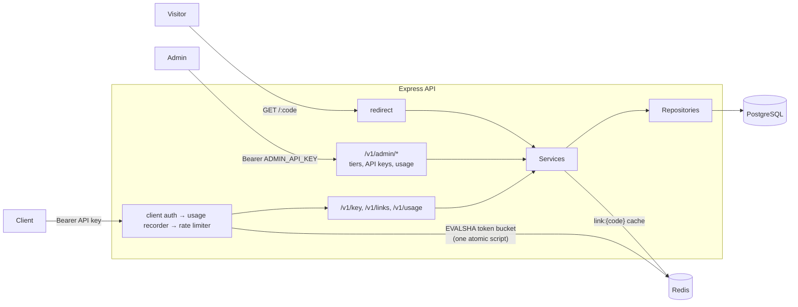
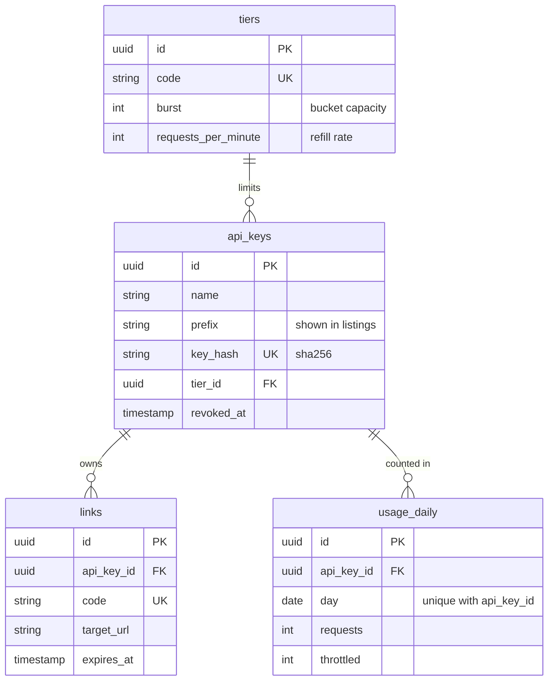

# api-platform-rate-limiter

A small public API platform whose product is a URL shortener. Clients call the API with **API keys**. Every key belongs to a **tier**, and each tier has its own **rate limit**, enforced by a token bucket in Redis that runs as one atomic Lua script. Short-link redirects are public and served from a Redis cache.

**What runs where:** everything runs locally with Docker (Postgres, Redis and the API). No cloud account or external service is needed. The project is **not deployed**.

**Stack:** Node 24, TypeScript (strict), Express 5, Prisma 7, PostgreSQL 16, Redis 7 (ioredis), Zod, `@asteasolutions/zod-to-openapi` with Swagger UI, Jest + Supertest, ESLint + Prettier.

## Architecture



Each feature module has the same shape: `routes → controller → service → repository` plus its own Zod `schemas`. Controllers only translate HTTP. Services hold the rules and never touch Express or Prisma. Repositories (and `LinkCache` for Redis) are the only data access.

```
src/
  common/        config, logger, errors + handler, validate, pagination, auth (client + admin),
                 Prisma and Redis singletons, base repository, OpenAPI helper (addRoute)
  rate-limiter/  token-bucket.ts (Lua script + TokenBucket), rate-limit.middleware.ts
  modules/       tiers, api-keys, links (+ link.cache.ts), usage (+ usage.middleware.ts)
  container.ts   composition root: wires every repository, service and controller
  app.ts         route mounting
scripts/         start-with-secrets.ts (container entrypoint)
prisma/          schema, migration, tier seed
tests/           unit/ (mocked repositories), integration/ (real Postgres + Redis)
```

## Data model



The seed adds three example tiers:

| Tier       | Burst | Requests per minute |
| ---------- | ----- | ------------------- |
| free       | 10    | 60                  |
| pro        | 50    | 600                 |
| enterprise | 200   | 6,000               |

## Run it

Requires Docker.

```bash
cp .env.example .env
docker compose up --build
```

This starts Postgres, Redis and a one-off `migrate` container (migration + tier seed), then the API on <http://localhost:3000>. Interactive docs are at <http://localhost:3000/docs>. Host ports default to **5441** (Postgres) and **6380** (Redis) to avoid clashing with local installs; override them with `POSTGRES_HOST_PORT`, `REDIS_HOST_PORT` and `API_HOST_PORT`.

A quick walkthrough:

```bash
ADMIN="Authorization: Bearer $(grep ADMIN_API_KEY .env | cut -d= -f2)"

# Pick the free tier and create an API key for it (the key is shown once)
TIER=$(curl -s localhost:3000/v1/admin/tiers -H "$ADMIN" | jq -r '.data[0].id')
KEY=$(curl -s localhost:3000/v1/admin/api-keys -H "$ADMIN" -H 'Content-Type: application/json' \
  -d "{\"name\":\"demo\",\"tierId\":\"$TIER\"}" | jq -r .data.key)

# Create a short link and follow it
curl -s localhost:3000/v1/links -H "Authorization: Bearer $KEY" -H 'Content-Type: application/json' \
  -d '{"targetUrl":"https://example.com","code":"hello"}' | jq .data.shortUrl
curl -si localhost:3000/hello | grep -i location

# Free tier: a burst of 10, so requests start returning 429 after the bucket empties
for i in $(seq 12); do curl -s -o /dev/null -w '%{http_code} ' localhost:3000/v1/key -H "Authorization: Bearer $KEY"; done
```

### Tests and lint

```bash
docker compose up -d postgres redis   # tests use the api_platform_test database and Redis db 1
npm ci
npm run lint
npm test                              # unit + integration
```

`npm run dev` runs the API with live reload from your shell, reading `.env`.

## Endpoints

Every response uses one envelope: `{ "data": … }`, plus `"meta": { page, pageSize, total, totalPages }` on lists. Errors are `{ "error": { "code", "message", "details"? } }`. Every list takes `?page=&pageSize=` (max 100). Bodies, query strings and path params are all validated, and the same Zod schemas generate the OpenAPI document.

| Method               | Path                                | Auth                                           |
| -------------------- | ----------------------------------- | ---------------------------------------------- |
| GET                  | `/health`, `/openapi.json`, `/docs` | public                                         |
| GET                  | `/:code`                            | public: 302 redirect, 404 unknown, 410 expired |
| GET · POST           | `/v1/admin/tiers`                   | admin                                          |
| GET · PATCH · DELETE | `/v1/admin/tiers/:id`               | admin (delete refused while keys use the tier) |
| GET · POST           | `/v1/admin/api-keys`                | admin (POST returns the raw key once)          |
| GET · PATCH          | `/v1/admin/api-keys/:id`            | admin (PATCH can move a key to another tier)   |
| POST                 | `/v1/admin/api-keys/:id/revoke`     | admin                                          |
| GET                  | `/v1/admin/api-keys/:id/usage`      | admin                                          |
| GET                  | `/v1/key`                           | API key: your key and its limits               |
| GET · POST           | `/v1/links`                         | API key                                        |
| GET · PATCH · DELETE | `/v1/links/:id`                     | API key (only your own links)                  |
| GET                  | `/v1/usage`                         | API key: your daily counts, `?from=&to=`       |

Client routes (`/v1/key`, `/v1/links`, `/v1/usage`) are rate limited and counted. Admin routes and redirects are not.

## Key design decisions

**A token bucket in one Lua script** (`src/rate-limiter/token-bucket.ts`). Each API key has a Redis hash `rl:{apiKeyId}` holding its token count and last-update time. The script runs these steps as one unit:

1. Read the bucket.
2. Add tokens for the time elapsed, capped at the tier's burst.
3. Take a token if one is there.
4. Write the bucket back.
5. Set a TTL, so idle buckets disappear (a missing bucket means "full").

Redis runs a script without interleaving other commands, so two API instances can never both spend the last token. The test sends 100 concurrent takes against a bucket of 10 and checks exactly 10 succeed. The script reads the time with Redis `TIME`, so every API instance uses the same clock. ioredis `defineCommand` sends the script once and then calls it by its SHA.

**Limits come from the tier on every request.** The tier's numbers are passed into the script on each call, so changing a key's tier, or a tier's limits, applies to the next request with no cache to clear. Responses carry `RateLimit-Limit` and `RateLimit-Remaining`. A 429 adds `Retry-After` (seconds) and the code `RATE_LIMITED`.

**No Strategy pattern for tiers.** Tiers differ only in two numbers, burst and refill rate, so one algorithm with per-tier parameters covers them. Strategy objects would add indirection without any behaviour that actually varies.

**Fail-open when Redis is down.** If the script can't run, the request is allowed and a warning is logged. Redis commands time out after 500 ms, so a Redis outage slows client requests by up to that much instead of hanging them. This trades strict limiting for availability: a Redis outage shouldn't take the whole API down. I checked this by stopping the Redis container: client requests and redirects kept working.

**Cache-aside for redirects** (`src/modules/links/link.cache.ts`). `GET /:code` reads `link:{code}` from Redis and only goes to Postgres on a miss. The entry lives for 5 minutes, or until the link expires if that's sooner. Updating or deleting a link deletes its entry. Cache errors count as a miss, so redirects fall back to Postgres. A test deletes the database row behind the API's back and checks the redirect is still served, which proves the hit never touches Postgres.

**API keys are stored as SHA-256 hashes.** A plain fast hash is enough because keys are 192 random bits; unlike passwords, they can't be guessed. The raw key is returned once. A short prefix is kept so admins can tell keys apart.

**Usage is counted after the response.** Middleware listens for the response's `finish` event, then increments that day's row for the key: `requests` for allowed requests, `throttled` for 429s. It runs before the rate limiter so throttled requests are seen. Prisma's upsert maps to `INSERT … ON CONFLICT DO UPDATE`; a test runs 30 concurrent first writes to the same day and gets one row with a count of 30.

**Docs generated from the validation schemas.** `addRoute()` (`src/common/openapi.ts`) registers the Express route and its OpenAPI operation from the same Zod schemas, so the docs can't describe a request shape the API doesn't actually accept. A test checks every route appears in `/openapi.json`.

**Redirect targets must be `http`/`https`**, which blocks `javascript:` and `data:` URLs. Custom codes can't collide with API paths (`v1`, `docs`, `health`).

**Patterns, only where they earn their place.**

- _Singleton:_ the Prisma client, the Redis client and config.
- _Repository:_ all data access, with a generic `BaseRepository` for CRUD.
- No Factory: this repo has no interchangeable providers.

## Known limitations

- **One admin key.** There are no admin users, roles or audit log, and rotating the admin key means changing config.
- **API key lookups hit Postgres on every request.** The rate limiter and redirects use Redis, but authentication doesn't cache keys.
- **Redirects are not rate limited.** A per-IP limit at the edge (CDN or WAF) would be the usual place for that.
- **No click analytics.** Usage counts API calls per key, not redirects per link.
- **Usage can under-count.** It's written after the response, so if the process exits between the response and the write, that request isn't counted. If Postgres is unavailable, the failure is logged and the count is skipped.
- **No negative caching.** Unknown codes always reach Postgres.
- **The fail-open choice is fixed in code.** There's no setting to fail closed instead.

## Deployment

| File                              | Purpose                                                                                                                                                                                                                                                                                             |
| --------------------------------- | --------------------------------------------------------------------------------------------------------------------------------------------------------------------------------------------------------------------------------------------------------------------------------------------------- |
| `Dockerfile`                      | Multi-stage build: compiles TypeScript, then ships production dependencies and `dist/` only. Runs as the non-root `node` user, with a healthcheck on `/health`.                                                                                                                                     |
| `scripts/start-with-secrets.ts`   | Container entrypoint. With `SECRETS_SOURCE=aws` it loads one JSON secret (`SECRET_ID`) from AWS Secrets Manager into the environment; with `local` it uses `.env`. It fails fast if the secret or a required key (`DATABASE_URL`, `REDIS_URL`, `ADMIN_API_KEY`) is missing, then starts the server. |
| `deploy/ecs-task-definition.json` | ECS Fargate task definition template with `${…}` placeholders for account id, region, image tag, role ARNs, secret id and public URL.                                                                                                                                                               |
| `.github/workflows/deploy.yml`    | Manual-only (`workflow_dispatch`) workflow. It assumes an AWS role through GitHub OIDC (no stored keys), builds and pushes the image to ECR, fills in the task definition and updates the ECS service.                                                                                              |
| `.github/workflows/ci.yml`        | Runs lint, typecheck and the full test suite against Postgres and Redis service containers on every push and pull request.                                                                                                                                                                          |

Deployment config is provided as a reference. This project has not been deployed.
